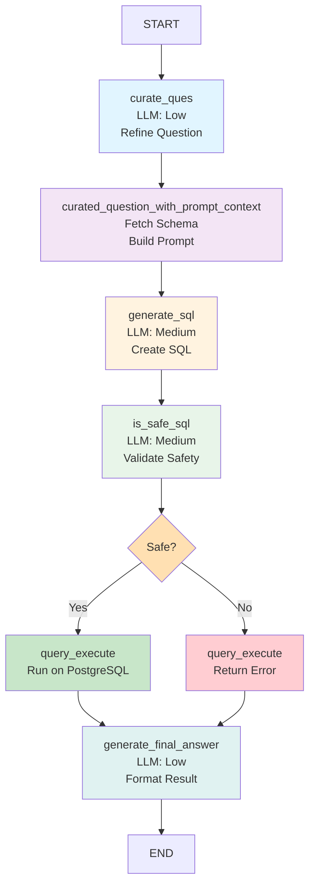
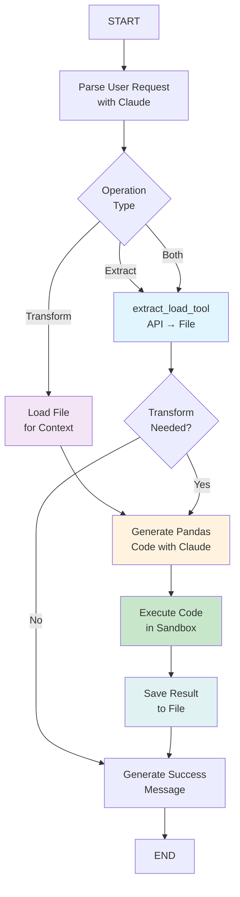

# Agent Workflows - Detailed Documentation

## SQL Analyst Agent Deep Dive

### Overview

The SQL Analyst Agent is a sophisticated 6-step pipeline that transforms natural language queries into secure, executable SQL commands and returns formatted results.

### Workflow Stages

#### Stage 1: Question Curation

**Objective**: Refine and clarify the user's natural language query

**LLM Used**: GPT-5.6-Luna (Low Complexity)

**Process**:
```python
def curate_ques(state: AgentSchema) -> AgentSchema:
    user_question = state.user_question
    llm = pick_llm("low")
    
    # Refine the question
    response = llm.invoke(
        f"Curate the following question: {user_question}"
    ).content
    
    state.curated_question = response
    state.messages.append(HumanMessage(content=response))
    return state
```

**Example**:
- **Input**: "Give me users who bought stuff recently"
- **Output**: "List all users who made purchases in the last 30 days with their purchase count and total spending"

**Benefits**:
- Removes ambiguity
- Adds missing context
- Improves SQL generation quality

---

#### Stage 2: Prompt Query Context

**Objective**: Gather database schema information and build instruction prompt

**Process**:
```python
def curated_question_with_prompt_context(state: AgentSchema) -> AgentSchema:
    curated_questiontion = state.curated_question
    
    # Connect to database
    conn_details = {...}
    db = DatabaseUtil(conn_details)
    
    # Fetch schema details for 'public' schema
    schema_info = db.schema_details("public")
    
    # Build comprehensive prompt
    prompt = f"""
    You are an SQL analyst agent. Convert the user's query into Postgres SQL.
    You have database schema details including table names, columns, data types,
    and sample data.
    
    User's Query: {curated_questiontion}
    
    Database Schema Details:
    {schema_info}
    """
    
    state.curated_question_with_prompt_context = prompt
    return state
```

**Schema Information Retrieved**:
```
Table: users
├── id (INTEGER, PRIMARY KEY)
├── name (VARCHAR)
├── email (VARCHAR)
└── created_at (TIMESTAMP)

Table: rides
├── id (INTEGER, PRIMARY KEY)
├── user_id (INTEGER, FOREIGN KEY)
├── distance (FLOAT)
├── cost (DECIMAL)
└── created_at (TIMESTAMP)

Sample Data:
  users: 1000 records
  rides: 5000 records
```

**Database Utility Method**:
```python
def schema_details(self, schema_name: str) -> str:
    """
    Retrieves detailed schema information including:
    - Table names and descriptions
    - Column names, types, and constraints
    - Foreign key relationships
    - Sample data (first 3-5 rows)
    - Row counts
    """
```

---

#### Stage 3: SQL Generation

**Objective**: Generate SQL query using LLM

**LLM Used**: GPT-5.6-Terra (Medium Complexity)

**Process**:
```python
def generate_sql(state: AgentSchema) -> AgentSchema:
    prompt = state.curated_question_with_prompt_context
    llm = pick_llm("medium")
    
    # Generate SQL
    generated_sql = llm.invoke(prompt).content
    
    # Clean output (remove markdown backticks if present)
    generated_sql = generated_sql.strip().strip('```sql').strip()
    
    state.generated_sql_query = generated_sql
    return state
```

**Output Example**:
```sql
SELECT 
    u.id,
    u.name,
    u.email,
    COUNT(r.id) as ride_count,
    SUM(r.cost) as total_spending,
    MAX(r.created_at) as last_ride_date
FROM users u
LEFT JOIN rides r ON u.id = r.user_id
WHERE r.created_at >= CURRENT_DATE - INTERVAL '30 days'
GROUP BY u.id, u.name, u.email
ORDER BY total_spending DESC
LIMIT 10;
```

**LLM Instructions**:
- Output only SQL, no explanations
- Use Postgres syntax
- Always limit to 10 rows unless specified
- Include appropriate JOINs and filtering
- Use meaningful aliases

---

#### Stage 4: Safety Validation

**Objective**: Validate SQL query doesn't modify database

**LLM Used**: GPT-5.6-Terra (Medium Complexity)

**Validation Rules**:
✅ **Allowed Operations**:
- SELECT statements
- Aggregations (COUNT, SUM, AVG, etc.)
- JOINs and subqueries
- Filtering and sorting

❌ **Blocked Operations**:
- INSERT, UPDATE, DELETE
- DROP, ALTER, CREATE
- TRUNCATE, REPLACE
- EXEC, EXECUTE
- Any DDL/DML operations

**Process**:
```python
def is_safe_sql(state: AgentSchema) -> AgentSchema:
    sql_query = state.generated_sql_query
    llm = pick_llm("medium")
    llm_judge = llm.with_structured_output(JudgeSchema)
    
    prompt = f"""
    Evaluate this SQL query for safety. Only SELECT operations are safe.
    Reject INSERT, UPDATE, DELETE, DROP, ALTER, etc.
    
    SQL Query:
    {sql_query}
    """
    
    result = llm_judge.invoke(prompt)
    
    state.is_safe = result.answer  # "Yes" or "No"
    state.comments = result.comments
    
    return state
```

**JudgeSchema Output**:
```python
class JudgeSchema(BaseModel):
    answer: Literal["Yes", "No"]  # Safety verdict
    comments: str                  # Detailed reasoning
```

**Example Validation Result**:
```json
{
    "answer": "Yes",
    "comments": "Query is safe. It only uses SELECT with JOINs and aggregations. No database modifications."
}
```

---

#### Stage 5: Query Execution

**Objective**: Execute validated SQL on PostgreSQL database

**Process**:
```python
def query_execute(state: AgentSchema) -> AgentSchema:
    sql_query = state.generated_sql_query
    
    if state.is_safe == "Yes":
        try:
            # Connect and execute
            db = DatabaseUtil(conn_details)
            results = db.execute_query(sql_query)
            
            state.sql_query_execution_result = results
            
        except Exception as e:
            state.sql_query_execution_result = f"Error: {str(e)}"
    else:
        state.sql_query_execution_result = \
            f"Query blocked for safety reasons: {state.comments}"
    
    return state
```

**Result Format**:
```python
# Pandas DataFrame or JSON
{
    "rows": [
        {"id": 1, "name": "John", "ride_count": 5, "total_spending": 150.50},
        {"id": 2, "name": "Jane", "ride_count": 8, "total_spending": 220.75},
        ...
    ],
    "columns": ["id", "name", "ride_count", "total_spending"],
    "row_count": 10,
    "execution_time_ms": 234
}
```

---

#### Stage 6: Answer Generation

**Objective**: Format results into human-readable answer

**LLM Used**: GPT-5.6-Luna (Low Complexity)

**Process**:
```python
def generate_final_answer(state: AgentSchema) -> AgentSchema:
    results = state.sql_query_execution_result
    original_question = state.user_question
    llm = pick_llm("low")
    
    prompt = f"""
    Based on the following query results, provide a clear, 
    natural language answer to the user's question.
    
    User's Question: {original_question}
    
    Query Results:
    {results}
    
    Provide insights and key findings.
    """
    
    final_answer = llm.invoke(prompt).content
    state.final_answer = final_answer
    
    return state
```

**Output Example**:
```
Top Users by Spending:
1. Jane Doe - 8 rides totaling $220.75 (last ride: 2024-08-29)
2. John Smith - 5 rides totaling $150.50 (last ride: 2024-08-28)
3. Sarah Johnson - 12 rides totaling $340.25 (last ride: 2024-08-30)

Key Insights:
- Average spending among active users: $237.17
- Sarah Johnson is our most active user in the last 30 days
- 3 users account for over $711 in revenue
```

---

### Complete SQL Agent Graph



---

## ETL Analyst Agent Deep Dive

### Overview

The ETL Analyst Agent orchestrates data extraction, transformation, and loading operations using a combination of specialized tools and LLM-powered decision making.

### Core Components

#### 1. Extract/Load Tool

**Purpose**: Fetch data from APIs and save to files

**Supported Formats**: CSV, JSON, Parquet

```python
@tool
def extract_load_tool(url: str, output_folder: str, format: str) -> str:
    """
    Extracts data from API endpoint and saves locally
    """
    etl = ETLTools()
    return etl.extract_load(url, output_folder, format)
```

**Implementation Details**:
```python
def extract_load(self, url: str, output_folder: str, format: str):
    try:
        # Step 1: Fetch data from API
        response = requests.get(url)
        response.raise_for_status()
        data = response.json()
        
        # Step 2: Normalize JSON to tabular format
        df = pd.json_normalize(data['results'])
        
        # Step 3: Create output directory
        project_root = os.path.abspath(...)
        output_path = os.path.join(project_root, output_folder)
        os.makedirs(output_path, exist_ok=True)
        
        # Step 4: Save in requested format
        filename = os.path.join(output_path, f"extracted_data.{format}")
        
        if format == "csv":
            df.to_csv(filename, index=False)
        elif format == "json":
            df.to_json(filename, orient="records", lines=True)
        elif format == "parquet":
            df.to_parquet(filename, index=False)
        
        return f"Success: Data saved to {filename}"
        
    except requests.exceptions.RequestException as e:
        return f"Failed to extract data: {e}"
```

**Example Usage**:
```python
# Extract Pokemon data
extract_load_tool(
    url="https://pokeapi.co/api/v2/pokemon",
    output_folder="data/extract",
    format="csv"
)

# Output: data/extract/extracted_data.csv
# Columns: name, height, weight, types, etc.
```

---

#### 2. Transform/Load Tool

**Purpose**: Apply Pandas transformations to data files

```python
@tool
def transform_load_tool(
    input_file_path: str,
    output_folder: str,
    output_format: str,
    user_question: str
) -> str:
    """
    Transforms data based on user requirements using generated Pandas code
    """
    etl = ETLTools()
    
    # Step 1: Get data preview/context
    context = etl.transform_load_context(input_file_path)
    
    # Step 2: Generate Pandas transformation code
    llm = pick_llm("claude")
    prompt = f"""
    You are a data analyst. Generate ONLY Pandas code.
    
    Input file: {input_file_path}
    Data preview:
    {context}
    
    User requirement: {user_question}
    
    Output only Python/Pandas code, no explanations.
    """
    
    pandas_code = llm.invoke(prompt).content
    pandas_code = pandas_code.strip().strip('```').strip('python').strip()
    
    # Step 3: Execute transformation
    result = etl.execute_code(pandas_code)
    
    # Step 4: Save result
    # (Code automatically saves to output_folder)
    
    return f"Transformation complete\nCode:\n{pandas_code}\nResult:\n{result}"
```

**LLM-Generated Code Example**:

Input:
```
User: "Calculate average price per category and sort descending"
```

Generated Pandas Code:
```python
import pandas as pd

# Read data
df = pd.read_csv('data/transform/products.csv')

# Calculate average price per category
result = df.groupby('category')['price'].mean().sort_values(ascending=False)

# Save result
result.to_csv('data/transform/avg_price_by_category.csv')

print(result)
```

---

#### 3. LLM Node & Tool Binding

**Purpose**: Intelligent decision making and tool orchestration

```python
def llm_node(state: ETLAgentSchema):
    messages = state.messages
    
    llm = pick_llm("claude")
    llm_bind = llm.bind_tools(tools)
    
    # LLM decides which tool to use and parameters
    prompt = """
    You are a data analyst with tools to:
    1. extract_load_tool: Fetch API data
    2. transform_load_tool: Apply Pandas transformations
    
    Based on the user request, decide which tool to use
    and provide the appropriate parameters.
    """
    
    response = llm_bind.invoke(
        [SystemMessage(content=prompt)] + messages
    )
    
    return state
```

---

### ETL Agent Workflow



---

### ETL Use Cases

#### Use Case 1: Simple Data Extraction

**Scenario**: Extract Pokemon data from API

**User Input**:
```
"Extract the data from https://pokeapi.co/api/v2/pokemon 
 and save it to data/extract folder in CSV format"
```

**Process Flow**:
1. Router classifies as ETL
2. ETL agent parses request
3. LLM identifies extract_load_tool needed
4. Tool fetches API data
5. JSON normalized to DataFrame
6. Saved as data/extract/extracted_data.csv

**Result**:
```csv
name,height,weight,types,abilities
bulbasaur,7,69,"['grass', 'poison']","['overgrow', 'chlorophyll']"
ivysaur,10,130,"['grass', 'poison']","['overgrow', 'chlorophyll']"
...
```

---

#### Use Case 2: Data Transformation

**Scenario**: Transform extracted data

**User Input**:
```
"Calculate the average weight per type and save results 
 to data/transform in Parquet format"
```

**Process Flow**:
1. LLM generates Pandas code:
```python
df = pd.read_csv('data/extract/extracted_data.csv')
df['types'] = df['types'].str.split(',').str[0]  # First type
result = df.groupby('types')['weight'].mean()
result.to_parquet('data/transform/avg_weight_by_type.parquet')
```

2. Code executed in sandboxed environment
3. Result saved to specified format

**Output**: data/transform/avg_weight_by_type.parquet

---

#### Use Case 3: Full ETL Pipeline

**Scenario**: Extract, transform, and load

**User Input**:
```
"Extract Pokemon data, calculate stats per type, 
 and save summary to data/transform in JSON format"
```

**Execution**:
1. Extract from API → CSV
2. Generate transformation code
3. Aggregate and summarize
4. Save as JSON

---

## State Management

### SQL Agent State Flow

```python
AgentSchema = {
    "messages": [HumanMessage, ...],
    "user_question": "original query",
    "curated_question": "refined query",
    "curated_question_with_prompt_context": "schema + instructions",
    "generated_sql_query": "SELECT ...",
    "is_safe": "Yes",
    "comments": "safety feedback",
    "sql_query_execution_result": "[results]",
    "final_answer": "formatted response"
}
```

**State Mutations Per Stage**:
- curate_ques: Adds `curated_question` and appends to `messages`
- curated_question_with_prompt_context: Sets `curated_question_with_prompt_context`
- generate_sql: Sets `generated_sql_query`
- is_safe_sql: Sets `is_safe` and `comments`
- query_execute: Sets `sql_query_execution_result`
- generate_final_answer: Sets `final_answer`

### ETL Agent State Flow

```python
ETLAgentSchema = {
    "messages": [HumanMessage, ...],
    # Additional fields managed by tools
}
```

---

## Error Handling

### SQL Agent Error Scenarios

| Scenario | Handling |
|----------|----------|
| Invalid SQL syntax | LLM regenerates, user notified |
| Unsafe query | Execution blocked, reason provided |
| Database error | Connection retry, detailed error log |
| Timeout | Query cancelled, partial results if available |
| Schema mismatch | Queries with valid alternatives suggested |

### ETL Agent Error Scenarios

| Scenario | Handling |
|----------|----------|
| API timeout | Retry with exponential backoff |
| Invalid format | Fallback to CSV |
| Code execution error | Error message with line numbers |
| File permissions | Create directories automatically |
| Disk full | Warning and operation cancellation |

---

