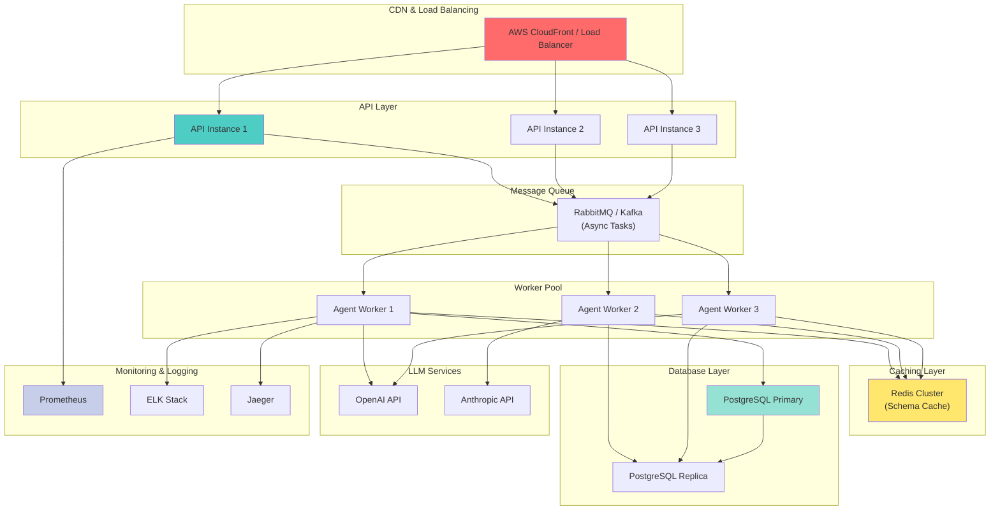

# Deployment, Best Practices & Troubleshooting

## Table of Contents

1. [Deployment Guide](#deployment-guide)
2. [Production Architecture](#production-architecture)
3. [Best Practices](#best-practices)
4. [Performance Optimization](#performance-optimization)
5. [Troubleshooting Guide](#troubleshooting-guide)
6. [Monitoring & Logging](#monitoring--logging)

---

## Deployment Guide

### Local Development Setup

```bash
# 1. Environment Setup
python -m venv venv
source venv/bin/activate

# 2. Dependencies
pip install -r requirements.txt

# 3. Configuration
cp .env.example .env
# Edit .env with your credentials

# 4. Database
python feed_db.py

# 5. Test
python -c "from agents.data_agent import data_agent; print('Setup OK')"
```

### Docker Deployment

**Dockerfile**:
```dockerfile
FROM python:3.12-slim

WORKDIR /app

# Install system dependencies
RUN apt-get update && apt-get install -y \
    postgresql-client \
    && rm -rf /var/lib/apt/lists/*

# Copy files
COPY requirements.txt .
RUN pip install --no-cache-dir -r requirements.txt

COPY . .

# Set environment
ENV PYTHONUNBUFFERED=1

# Run application
CMD ["python", "main.py"]
```

**docker-compose.yml**:
```yaml
version: '3.8'

services:
  postgres:
    image: postgres:15
    environment:
      POSTGRES_DB: data_db
      POSTGRES_USER: postgres
      POSTGRES_PASSWORD: password
    ports:
      - "5432:5432"
    volumes:
      - postgres_data:/var/lib/postgresql/data

  agent:
    build: .
    depends_on:
      - postgres
    environment:
      - host=postgres
      - port=5432
      - user=postgres
      - password=password
      - database=data_db
      - OPENAI_API_KEY=${OPENAI_API_KEY}
      - ANTHROPIC_API_KEY=${ANTHROPIC_API_KEY}
    ports:
      - "8000:8000"

volumes:
  postgres_data:
```

**Run Docker**:
```bash
docker-compose up -d
```

### Kubernetes Deployment

**deployment.yaml**:
```yaml
apiVersion: apps/v1
kind: Deployment
metadata:
  name: ai-data-agent
spec:
  replicas: 3
  selector:
    matchLabels:
      app: ai-data-agent
  template:
    metadata:
      labels:
        app: ai-data-agent
    spec:
      containers:
      - name: agent
        image: your-registry/ai-data-agent:1.0.0
        env:
        - name: host
          valueFrom:
            configMapKeyRef:
              name: agent-config
              key: db_host
        - name: port
          valueFrom:
            configMapKeyRef:
              name: agent-config
              key: db_port
        resources:
          requests:
            memory: "256Mi"
            cpu: "250m"
          limits:
            memory: "512Mi"
            cpu: "500m"
        livenessProbe:
          httpGet:
            path: /health
            port: 8000
          initialDelaySeconds: 30
          periodSeconds: 10
```

### Cloud Deployment Options

#### AWS Deployment
```bash
# Using AWS Lambda + RDS
1. Package application
2. Upload to AWS Lambda
3. Configure RDS PostgreSQL
4. Set environment variables
5. Deploy with AWS SAM CLI
```

#### Google Cloud Deployment
```bash
# Using Cloud Run + Cloud SQL
gcloud run deploy ai-data-agent \
  --source . \
  --platform managed \
  --region us-central1 \
  --set-env-vars DB_HOST=cloud-sql-host

gcloud sql instances create data-db \
  --database-version POSTGRES_15 \
  --tier db-f1-micro
```

#### Azure Deployment
```bash
# Using Container Instances + Azure Database for PostgreSQL
az container create \
  --name ai-data-agent \
  --image your-registry/ai-data-agent:1.0.0 \
  --environment-variables \
    host=your-postgres-server.postgres.database.azure.com \
    OPENAI_API_KEY=$OPENAI_API_KEY
```

---

## Production Architecture

### High-Availability Architecture



### Recommended Setup for Production

```
┌─────────────────────────────────────────────────────────┐
│                    Load Balancer                        │
│           (AWS ALB / Azure LB / GCP LB)                │
└────────────┬────────────────────────────┬───────────────┘
             │                            │
    ┌────────▼──────────┐        ┌────────▼──────────┐
    │   Region 1        │        │   Region 2        │
    │                   │        │                   │
    │  ┌─────────────┐  │        │  ┌─────────────┐  │
    │  │ App Server  │  │        │  │ App Server  │  │
    │  │ (x3)        │  │        │  │ (x3)        │  │
    │  └──────┬──────┘  │        │  └──────┬──────┘  │
    │         │         │        │         │         │
    │  ┌──────▼──────┐  │        │  ┌──────▼──────┐  │
    │  │  Redis      │  │        │  │  Redis      │  │
    │  │  (Cache)    │  │        │  │  (Cache)    │  │
    │  └─────────────┘  │        │  └─────────────┘  │
    │                   │        │                   │
    └───────────────────┘        └───────────────────┘
             │                            │
             └────────────┬───────────────┘
                          │
                  ┌───────▼────────┐
                  │  PostgreSQL    │
                  │  Primary (M)   │
                  └───────┬────────┘
                          │
        ┌─────────────────┼─────────────────┐
        │                 │                 │
    ┌───▼────┐      ┌─────▼────┐      ┌────▼──┐
    │Replica1│      │Replica2  │      │Replica│
    │(R)     │      │(R)       │      │(R)    │
    └────────┘      └──────────┘      └───────┘
```

---

## Best Practices

### 1. Query Design

#### ✅ DO

```python
# Specific and clear
"Show me the top 5 users by total ride spending in the last 30 days"

# Include constraints
"Get users from the 'premium' plan with more than 10 rides"

# Specify output format
"List user IDs, names, and total rides in descending order"
```

#### ❌ DON'T

```python
# Too vague
"Get user data"

# No constraints
"Show all rides"

# Ambiguous intent
"Analyze the data"
```

### 2. Error Handling

```python
from agents.data_agent import data_agent
from langchain_core.messages import HumanMessage
import logging

logger = logging.getLogger(__name__)

def safe_agent_invoke(query: str, max_retries: int = 3) -> dict:
    """
    Safely invoke agent with retry logic and error handling
    """
    for attempt in range(max_retries):
        try:
            response = data_agent.invoke({
                "messages": [HumanMessage(content=query)],
                "route_response": ""
            })
            
            # Check for errors in response
            if "error" in str(response).lower():
                logger.warning(f"Agent returned error: {response}")
                if attempt < max_retries - 1:
                    continue
                return {"error": response}
            
            return response
            
        except TimeoutError:
            logger.error(f"Timeout on attempt {attempt + 1}")
            if attempt < max_retries - 1:
                continue
            raise
            
        except Exception as e:
            logger.error(f"Error on attempt {attempt + 1}: {e}")
            if attempt < max_retries - 1:
                continue
            raise
    
    return {"error": "Max retries exceeded"}
```

### 3. Resource Management

```python
# Connection pooling
from utils.database import DatabaseUtil

class DatabasePool:
    def __init__(self, conn_details, pool_size: int = 10):
        self.pool_size = pool_size
        self.available = []
        self.in_use = set()
        
        for _ in range(pool_size):
            conn = DatabaseUtil(conn_details)
            self.available.append(conn)
    
    def get_connection(self):
        if self.available:
            conn = self.available.pop()
            self.in_use.add(id(conn))
            return conn
        raise RuntimeError("No available connections")
    
    def return_connection(self, conn):
        self.in_use.discard(id(conn))
        self.available.append(conn)
```

### 4. Input Validation

```python
from pydantic import BaseModel, validator
import re

class QueryRequest(BaseModel):
    query: str
    format: str = "text"
    max_results: int = 100
    
    @validator('query')
    def query_not_empty(cls, v):
        if not v or len(v.strip()) < 3:
            raise ValueError("Query must be at least 3 characters")
        return v.strip()
    
    @validator('format')
    def valid_format(cls, v):
        if v not in ["text", "json", "csv"]:
            raise ValueError("Invalid format")
        return v
    
    @validator('max_results')
    def valid_max_results(cls, v):
        if v < 1 or v > 10000:
            raise ValueError("Max results must be between 1 and 10000")
        return v

# Usage
request = QueryRequest(
    query="Show top users",
    format="json",
    max_results=50
)
```

### 5. Security Practices

```python
# 1. Never expose API keys in logs
import os
from dotenv import load_dotenv

load_dotenv()
api_key = os.environ.get('OPENAI_API_KEY')
# Don't print: print(api_key)

# 2. Sanitize user input
import html

def sanitize_input(user_input: str) -> str:
    """Remove potentially harmful characters"""
    # Remove HTML tags
    sanitized = html.escape(user_input)
    # Remove special characters that could cause issues
    sanitized = re.sub(r'[;`$()]', '', sanitized)
    return sanitized

# 3. Use environment variables for configuration
db_config = {
    "host": os.environ.get('DB_HOST'),
    "port": int(os.environ.get('DB_PORT', 5432)),
    "user": os.environ.get('DB_USER'),
    "password": os.environ.get('DB_PASSWORD'),
    "dbname": os.environ.get('DB_NAME')
}

# 4. Implement request signing for APIs
import hmac
import hashlib

def generate_signature(request_body: str, secret: str) -> str:
    return hmac.new(
        secret.encode(),
        request_body.encode(),
        hashlib.sha256
    ).hexdigest()
```

---

## Performance Optimization

### 1. Query Optimization

```python
# SLOW: Getting all users then filtering
users = db.execute_query("SELECT * FROM users")
active_users = [u for u in users if u['rides'] > 10]

# FAST: Filter in database
query = """
SELECT * FROM users 
WHERE id IN (
    SELECT user_id FROM rides 
    GROUP BY user_id 
    HAVING COUNT(*) > 10
) LIMIT 100
"""
active_users = db.execute_query(query)
```

### 2. Caching Strategy

```python
from functools import lru_cache
from datetime import datetime, timedelta

class CacheManager:
    def __init__(self, ttl_seconds: int = 3600):
        self.cache = {}
        self.ttl = ttl_seconds
    
    def get(self, key: str):
        if key in self.cache:
            value, timestamp = self.cache[key]
            if datetime.now() - timestamp < timedelta(seconds=self.ttl):
                return value
            else:
                del self.cache[key]
        return None
    
    def set(self, key: str, value):
        self.cache[key] = (value, datetime.now())
    
    def invalidate(self, key: str):
        if key in self.cache:
            del self.cache[key]

# Usage
cache = CacheManager(ttl_seconds=3600)

def get_schema_info(schema_name: str):
    cache_key = f"schema:{schema_name}"
    
    # Check cache
    cached = cache.get(cache_key)
    if cached:
        return cached
    
    # Fetch from database
    schema_info = db.schema_details(schema_name)
    
    # Store in cache
    cache.set(cache_key, schema_info)
    
    return schema_info
```

### 3. Batch Processing

```python
def batch_queries(queries: list[str], batch_size: int = 10) -> list[dict]:
    """Process multiple queries efficiently"""
    results = []
    
    for i in range(0, len(queries), batch_size):
        batch = queries[i:i + batch_size]
        
        # Process batch in parallel
        batch_results = []
        
        for query in batch:
            result = data_agent.invoke({
                "messages": [HumanMessage(content=query)],
                "route_response": ""
            })
            batch_results.append(result)
        
        results.extend(batch_results)
    
    return results
```

### 4. Async Processing

```python
import asyncio
from concurrent.futures import ThreadPoolExecutor

executor = ThreadPoolExecutor(max_workers=10)

async def async_agent_invoke(query: str):
    """Non-blocking agent invocation"""
    loop = asyncio.get_event_loop()
    result = await loop.run_in_executor(
        executor,
        lambda: data_agent.invoke({
            "messages": [HumanMessage(content=query)],
            "route_response": ""
        })
    )
    return result

# Usage
async def process_multiple_queries(queries: list[str]):
    tasks = [async_agent_invoke(q) for q in queries]
    results = await asyncio.gather(*tasks)
    return results
```

---

## Troubleshooting Guide

### Database Issues

#### Issue: "Connection refused" to PostgreSQL

**Symptoms**:
```
psycopg2.OperationalError: could not connect to server: 
Connection refused
```

**Solutions**:
```bash
# 1. Check PostgreSQL is running
sudo systemctl status postgresql

# 2. Verify credentials
psql -h localhost -U postgres -d data_db

# 3. Check connection details in .env
cat .env | grep -E "host|port|user|password|database"

# 4. Test connection string
python -c "
from utils.database import DatabaseUtil
db = DatabaseUtil({
    'host': 'localhost',
    'port': 5432,
    'user': 'postgres',
    'password': 'password',
    'dbname': 'data_db'
})
print('Connection successful')
"
```

### LLM API Issues

#### Issue: "API key not found"

**Symptoms**:
```
AuthenticationError: Incorrect API key provided
```

**Solutions**:
```bash
# 1. Verify API keys are set
echo $OPENAI_API_KEY
echo $ANTHROPIC_API_KEY

# 2. Check .env file
cat .env | grep API_KEY

# 3. Reload environment
source .env
python your_script.py

# 4. Test individual LLM
python -c "
from utils.llm_pick import pick_llm
llm = pick_llm('low')
response = llm.invoke('Hello')
print(response)
"
```

#### Issue: "Rate limit exceeded"

**Symptoms**:
```
RateLimitError: Rate limit exceeded. Retry after 60 seconds
```

**Solutions**:
```python
# Implement exponential backoff
import time
from tenacity import retry, stop_after_attempt, wait_exponential

@retry(
    stop=stop_after_attempt(5),
    wait=wait_exponential(multiplier=1, min=2, max=10)
)
def call_llm_with_retry(prompt: str):
    llm = pick_llm("low")
    return llm.invoke(prompt)

# Usage
try:
    response = call_llm_with_retry("Your prompt")
except Exception as e:
    print(f"Failed after retries: {e}")
```

### Query Generation Issues

#### Issue: "Generated SQL syntax error"

**Symptoms**:
```
psycopg2.ProgrammingError: syntax error at or near "SELECT"
```

**Solutions**:
```python
# 1. Validate generated SQL
import sqlparse

def validate_sql(sql: str) -> bool:
    try:
        parsed = sqlparse.parse(sql)
        return len(parsed) > 0 and parsed[0].get_type() == 'SELECT'
    except:
        return False

# 2. Add more context to LLM
prompt = f"""
Generate a valid PostgreSQL SELECT query.
Tables available: {schema_info}
User question: {question}

Output ONLY valid SQL, nothing else.
Start with SELECT and end with semicolon.
"""

# 3. Post-process SQL
def clean_sql(sql: str) -> str:
    sql = sql.strip()
    if sql.startswith('```'):
        sql = sql.split('```')[1].strip()
    if not sql.endswith(';'):
        sql += ';'
    return sql
```

### File System Issues

#### Issue: "Permission denied" writing files

**Symptoms**:
```
PermissionError: [Errno 13] Permission denied: 'data/extract/file.csv'
```

**Solutions**:
```bash
# 1. Check directory permissions
ls -la data/
chmod -R 755 data/

# 2. Check file ownership
chown -R user:group data/

# 3. Ensure directories exist
mkdir -p data/extract
mkdir -p data/transform

# 4. Test file writing
python -c "
import os
os.makedirs('data/test', exist_ok=True)
with open('data/test/test.txt', 'w') as f:
    f.write('test')
print('Write successful')
"
```

---

## Monitoring & Logging

### Structured Logging

```python
import logging
import json
from datetime import datetime

class JSONFormatter(logging.Formatter):
    def format(self, record):
        log_data = {
            'timestamp': datetime.utcnow().isoformat(),
            'level': record.levelname,
            'logger': record.name,
            'message': record.getMessage(),
            'module': record.module,
            'function': record.funcName,
            'line': record.lineno
        }
        
        if record.exc_info:
            log_data['exception'] = self.formatException(record.exc_info)
        
        return json.dumps(log_data)

# Setup logging
handler = logging.StreamHandler()
handler.setFormatter(JSONFormatter())

logger = logging.getLogger('ai_data_agent')
logger.setLevel(logging.INFO)
logger.addHandler(handler)
```

### Key Metrics to Monitor

```python
from dataclasses import dataclass
from datetime import datetime

@dataclass
class QueryMetric:
    query: str
    route_type: str  # "sql" or "etl"
    processing_time_ms: float
    llm_calls: int
    tokens_used: int
    success: bool
    error_message: str = None
    timestamp: datetime = None

    def log(self):
        logger.info(json.dumps({
            'event': 'query_processed',
            'query_type': self.route_type,
            'processing_time_ms': self.processing_time_ms,
            'llm_calls': self.llm_calls,
            'tokens_used': self.tokens_used,
            'success': self.success,
            'error': self.error_message,
            'timestamp': self.timestamp.isoformat()
        }))

# Usage
import time

start = time.time()

try:
    response = data_agent.invoke({
        "messages": [HumanMessage(content=query)],
        "route_response": ""
    })
    
    metric = QueryMetric(
        query=query,
        route_type=response.get('route_response', 'unknown'),
        processing_time_ms=(time.time() - start) * 1000,
        llm_calls=response.get('llm_calls', 0),
        tokens_used=response.get('tokens_used', 0),
        success=True,
        timestamp=datetime.now()
    )
    
except Exception as e:
    metric = QueryMetric(
        query=query,
        route_type='unknown',
        processing_time_ms=(time.time() - start) * 1000,
        llm_calls=0,
        tokens_used=0,
        success=False,
        error_message=str(e),
        timestamp=datetime.now()
    )

metric.log()
```

### Prometheus Metrics

```python
from prometheus_client import Counter, Histogram, Gauge

# Define metrics
query_counter = Counter(
    'queries_total',
    'Total queries processed',
    ['route_type', 'status']
)

query_duration = Histogram(
    'query_duration_seconds',
    'Query processing duration',
    ['route_type']
)

active_queries = Gauge(
    'active_queries',
    'Number of active queries'
)

llm_tokens = Counter(
    'llm_tokens_total',
    'Total LLM tokens used',
    ['model', 'type']
)

# Usage
with query_duration.labels(route_type='sql').time():
    response = data_agent.invoke(...)
    
query_counter.labels(route_type='sql', status='success').inc()
llm_tokens.labels(model='gpt-5.6-terra', type='prompt').inc(token_count)
```

---

