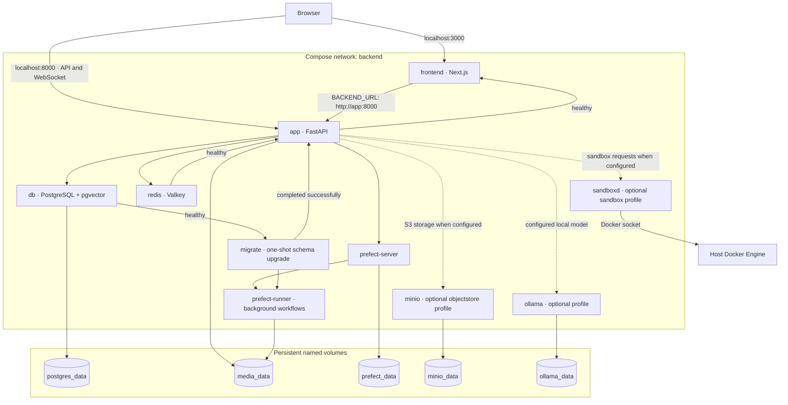
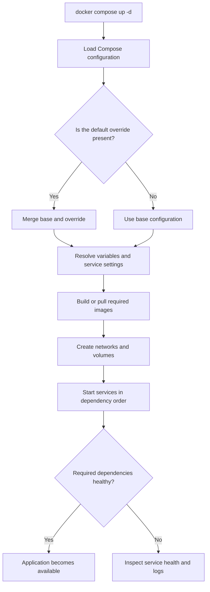
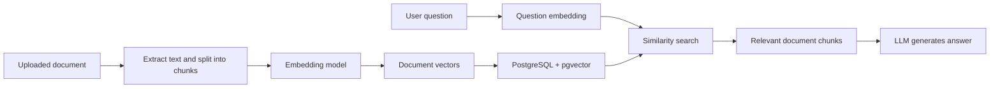
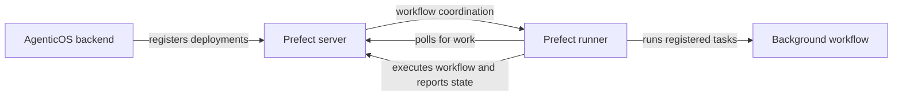
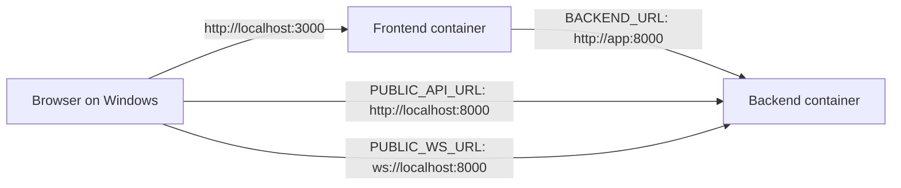
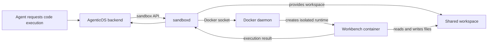
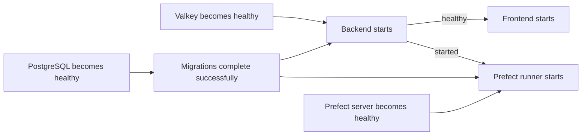
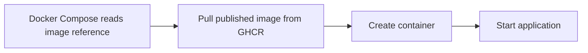

# **AgenticOS Docker Compose — Complete Architecture & Deep Dive**

Think of this `docker-compose.yml` file as the **blueprint of an entire AI operating system running on your computer**.

Instead of manually installing Python, PostgreSQL, Redis, Prefect, the frontend, and the backend, Docker Compose coordinates all of them and makes them work together.

With one command:

```
docker compose up -d
```

You can start an entire AgenticOS environment.

But the interesting part is not just starting containers. It's understanding **how the services communicate, how they depend on each other, how data is stored, how AI agents execute tasks, and how the whole system stays alive.**

Let's break it down like we're designing a production-grade distributed system.

# **1. The big picture: What are we building?**

Your AgenticOS environment has several major components:

# AgenticOS architecture in `docker-compose.yml`

This diagram follows the services and connections in the root Compose file.
Optional profile services use dashed arrows.



The browser uses host-published ports. Containers use Compose service names:
the frontend reaches the API at `app:8000`, and the API reaches `db`, `redis`
and `prefect-server` on the `backend` network.

There are three important ideas to understand:

1. **Services:** Individual applications running in containers.
2. **Networks:** How containers communicate with each other.
3. **Volumes:** How containers preserve data even after they stop or are recreated.

Let's understand each one.

# **2. What exactly is Docker Compose?**

First, distinguish between Docker and Docker Compose.

| Technology       | Responsibility                       |
| ---------------- | ------------------------------------ |
| Docker Engine    | Runs containers                      |
| Docker Image     | Blueprint used to create a container |
| Docker Container | Running instance of an image         |
| Docker Compose   | Coordinates multiple containers      |
| Docker Network   | Allows containers to communicate     |
| Docker Volume    | Preserves persistent data            |

Imagine you are building a company.

- PostgreSQL is your data department.
- Redis/Valkey is your fast-memory department.
- Backend is your operations department.
- Frontend is your customer-facing department.
- Prefect is your workflow manager.
- Sandboxd is your isolated execution laboratory.

Docker Compose is the manager that starts everyone, connects them, and ensures they follow the correct startup order.

## **How Compose reads your configuration**

When you run:

```
docker compose up -d
```

Compose performs roughly this process:



Important: `-d` means detached mode. Docker runs the containers in the background, so your terminal is free.

# **3. Understand the services one by one**

Your Compose file defines 11 services. Some are essential; others are optional.

## **3.1&#x20;**`migrate`**&#x20;— The database preparation service**

```
migrate:
  image: ghcr.io/vstorm-co/agenticos-backend:${AGENTICOS_VERSION:-latest}
  command: agenticos db upgrade
```

Runs before the application

This is one of the most important services in the entire architecture.

Imagine PostgreSQL is a brand-new building. It exists, but it has no tables, no relationships, and no database structure.

Your application expects tables such as users, conversations, agents, and other application-specific records to exist.

The migration service prepares the database.

**What happens when it runs?**

1. Downloads the backend image if necessary.
2. Connects to PostgreSQL.
3. Executes `agenticos db upgrade`.
4. Applies pending database migrations.
5. Exits successfully when migration is complete.

The command:

```
depends_on:
  db:
    condition: service_healthy
```

means:

> Do not run database migrations until PostgreSQL is healthy.

And this:

```
restart: "no"
```

means Docker does not automatically restart the migration container after it exits.

This is intentional. Migration is a one-time startup operation, not a continuously running server.

**Why does the backend depend on migration?**

Because starting an API against an unprepared database can cause errors such as:

- Missing tables.
- Missing columns.
- Missing indexes.
- Incompatible database schema.

Think of migrations as preparing the foundation before constructing the building.

## **3.2&#x20;**`app`**&#x20;— The brain of AgenticOS**

```
app:
  image: ghcr.io/vstorm-co/agenticos-backend:${AGENTICOS_VERSION:-latest}
  ports:
    - "8000:8000"
  command: >-
    uvicorn app.main:app --host 0.0.0.0 --port 8000
    --workers ${UVICORN_WORKERS:-1} --ws websockets-sansio
```

Core application

This is the actual backend application.

It uses FastAPI and Uvicorn.

Let's understand the command.

```
uvicorn app.main:app
```

This means:

- `uvicorn`: ASGI web server.
- `app.main`: Python module.
- `app`: FastAPI application object inside that module.

The full command:

```
uvicorn app.main:app \
  --host 0.0.0.0 \
  --port 8000 \
  --workers 1 \
  --ws websockets-sansio
```

### **Why&#x20;**`0.0.0.0`**?**

This is very important.

Suppose your backend listens only on:

```
127.0.0.1:8000
```

It listens on its own container's loopback interface.

Other containers cannot access it through the Docker network.

But:

```
0.0.0.0:8000
```

means the server listens on all available network interfaces inside the container.

This allows the frontend to reach it.

### **Understanding port mapping**

```
ports:
  - "8000:8000"
```

The format is:

```
HOST_PORT:CONTAINER_PORT
```

## **Port mapping example**

**Your Windows computer**

# **8000**

localhost:8000

Docker port forwarding

**Backend container**

# **8000**

0.0.0.0:8000

Now you can access the backend from your host:

```
http://localhost:8000
```

### **Why only one worker?**

```
--workers ${UVICORN_WORKERS:-1}
```

This is configurable.

If you don't specify `UVICORN_WORKERS`, it uses one worker.

For example:

```
UVICORN_WORKERS=4
```

would start four workers.

Each worker imports the application separately and consumes memory. The comments mention approximately 460 MiB per worker in the measured environment.

So four workers could require roughly 1.8 GiB just for application worker processes.

This is why increasing workers without considering RAM is dangerous.

### **What does&#x20;**`websockets-sansio`**&#x20;do?**

AgenticOS supports chat over WebSockets.

Normal HTTP:

```
Request → Response → Connection ends
```

WebSocket:

```
Client ←→ Server
      Persistent connection
```

This is useful for:

- Streaming AI responses.
- Real-time chat.
- Live execution updates.
- Agent status updates.

The configuration selects a specific WebSocket implementation to avoid compatibility problems with newer versions of the `websockets` package.

### **The health check**

```
healthcheck:
  test:
    - CMD
    - python
    - -c
    - import httpx; httpx.get('http://localhost:8000/api/v1/health').raise_for_status()
```

Docker periodically checks:

```
http://localhost:8000/api/v1/health
```

If the endpoint responds successfully, the container is considered healthy.

Notice that the code uses:

```
.raise_for_status()
```

This is important because receiving an HTTP response does not necessarily mean the application is healthy. HTTP 500 is still a response.

## **3.3&#x20;**`db`**&#x20;— PostgreSQL with pgvector**

```
db:
  image: pgvector/pgvector:pg16
```

Persistent database

This service is your primary relational database.

It stores structured application data.

Examples:

- Users.
- Conversations.
- Messages.
- Agent configurations.
- Workflow metadata.
- Application records.

But there is something special about this image.

It is not simply:

```
image: postgres:16-alpine
```

It is:

```
image: pgvector/pgvector:pg16
```

### **What is pgvector?**

pgvector is a PostgreSQL extension that enables vector storage and similarity search.

This is particularly useful for RAG (Retrieval-Augmented Generation).

Imagine uploading a document:

```
Artificial Intelligence is transforming business...
```

An embedding model converts the text into a numerical vector:

```
[0.123, -0.542, 0.821, 0.334, ...]
```

PostgreSQL can store these vectors and search for semantically similar content.

For example:

User asks:

> What does the document say about AI in business?

The system can retrieve relevant document chunks based on vector similarity, even if the exact words differ.

### **How RAG works**



**Why is the correct image important?**

The comments explain that the application requires the PostgreSQL `vector` extension.

A normal PostgreSQL image may not contain it.

Using the pgvector image ensures the extension is available when the application needs it.

### **Database environment variables**

```
environment:
  - POSTGRES_USER=${POSTGRES_USER:-postgres}
  - POSTGRES_PASSWORD=${POSTGRES_PASSWORD:-postgres}
  - POSTGRES_DB=${POSTGRES_DB:-agenticos}
```

These define:

| Variable          | Meaning           | Default   |
| ----------------- | ----------------- | --------- |
| POSTGRES_USER     | Database username | postgres  |
| POSTGRES_PASSWORD | Database password | postgres  |
| POSTGRES_DB       | Database name     | agenticos |

The database is available to other containers using:

```
Host: db
Port: 5432
```

Notice that `db` is the service name, not `localhost`.

This distinction is fundamental to Docker networking.

## **3.4&#x20;**`redis`**&#x20;— Actually Valkey**

```
redis:
  image: valkey/valkey:8-alpine
  command: valkey-server --save ''
```

Fast in-memory storage

The service is named `redis`, but the image is Valkey.

Why?

Valkey is an open-source, Redis-protocol-compatible alternative.

The application can continue using its Redis-compatible configuration:

```
REDIS_HOST=redis
```

without needing to change the service name.

### **What does it do?**

PostgreSQL is your persistent database.

Valkey is your fast temporary storage and coordination layer.

Examples of possible uses include:

- Rate-limit counters.
- Deduplication claims.
- Membership information.
- Temporary coordination state.

The comments specifically mention that these values have TTLs.

TTL means Time To Live.

For example:

```
rate_limit:user_123 = 10
TTL = 60 seconds
```

After 60 seconds, the key expires automatically.

### **Why no volume?**

```
command: valkey-server --save ''
```

This disables RDB snapshot persistence.

The design assumes that the temporary data can be reconstructed.

Therefore, a persistent disk volume is unnecessary.

This is a deliberate architectural decision, not an accidental omission.

## **3.5&#x20;**`prefect-server`**&#x20;— The workflow manager**

```
prefect-server:
  image: prefecthq/prefect:3.8.8-python3.12
  command: prefect server start --host 0.0.0.0
```

Workflow orchestration

This is where things become interesting.

AgenticOS does not only respond to user requests. It also needs to manage longer-running tasks and workflows.

Imagine asking an AI agent:

> Analyze this Excel file, generate a report, and save it.

This can involve multiple steps.

Instead of treating everything as one simple HTTP request, workflow orchestration helps manage execution.

Prefect provides infrastructure for:

- Workflow registration.
- Scheduling.
- Task execution tracking.
- Run states.
- Retry and orchestration capabilities.
- Workflow monitoring.

### **Prefect server versus Prefect runner**

These are two different responsibilities.

**Prefect Server**

The control plane.

It manages workflow metadata and provides the orchestration API.

**Prefect Runner**

The execution side.

It runs the registered workflow deployments.

Think of an airline:

- Prefect Server = Flight control tower.
- Prefect Runner = Aircraft executing the assigned route.

Here is the relationship:



### **Why this API URL?**

```
PREFECT_API_URL=http://prefect-server:4200/api
```

Because both services are on the same Docker network.

The runner does not need to use:

```
http://localhost:4200/api
```

It uses the service DNS name:

```
http://prefect-server:4200/api
```

### **Why port 4200?**

Prefect's server listens on port 4200.

Your Compose file does not publish that port to the host.

However, other containers on the internal network can access it.

The Prefect UI is therefore not directly exposed through a host port in this configuration.

### **Persistent Prefect data**

```
volumes:
  - prefect_data:/root/.prefect/
```

This preserves Prefect's local data across container recreation.

## **3.6&#x20;**`prefect-runner`**&#x20;— The workflow executor**

```
prefect-runner:
  command: python -m app.worker.prefect_app
```

This is not the Prefect server.

It is an AgenticOS-specific Python process that connects to Prefect and executes the registered work.

It uses the same backend image as the main application, but runs a different command.

Compare:

| Container      | Command                            | Purpose            |
| -------------- | ---------------------------------- | ------------------ |
| app            | `uvicorn app.main:app`             | HTTP API           |
| prefect-runner | `python -m app.worker.prefect_app` | Workflow execution |

Both use the same Python codebase, but they serve different responsibilities.

### **Its health check**

```
PREFECT_RUNNER_SERVER_HOST: 127.0.0.1
PREFECT_RUNNER_SERVER_PORT: 8080
```

The runner exposes a local health endpoint:

```
http://127.0.0.1:8080/health
```

The health check verifies whether the runner is actually polling and working.

This is more meaningful than simply checking whether the Python process exists.

A process can be alive but unable to perform its job.

## **3.7&#x20;**`frontend`**&#x20;— The user interface**

```
frontend:
  image: ghcr.io/vstorm-co/agenticos-frontend:${AGENTICOS_VERSION:-latest}
  ports:
    - "3000:3000"
```

This is the frontend of AgenticOS.

It is the interface you interact with in your browser.

The frontend image is hosted separately from the backend:

```
ghcr.io/vstorm-co/agenticos-frontend
```

The backend image is:

```
ghcr.io/vstorm-co/agenticos-backend
```

They are separate applications, even though they are deployed together.

### **Understanding the three important URLs**

```
BACKEND_URL=http://app:8000

PUBLIC_API_URL=http://localhost:8000

PUBLIC_WS_URL=ws://localhost:8000
```

These are NOT interchangeable.

| Variable       | Used by         | Destination               |
| -------------- | --------------- | ------------------------- |
| BACKEND_URL    | Frontend server | Backend container         |
| PUBLIC_API_URL | Browser         | Host-accessible API       |
| PUBLIC_WS_URL  | Browser         | Host-accessible WebSocket |

Let's understand why.

Imagine your browser visits:

```
http://localhost:3000
```

The frontend container makes a server-side request to the backend.

It uses:

```
http://app:8000
```

because `app` is a Docker service name.

But your browser is running on Windows, outside the Docker network.

Your browser cannot normally resolve the internal Docker hostname `app`.

Therefore, it uses:

```
http://localhost:8000
```

This is one of the most important concepts in this Compose file.

### **Visualizing the difference**



### **What if you access AgenticOS through another machine?**

Suppose your server's IP address is:

```
192.168.1.100
```

Then your browser needs to know that address.

You would configure:

```
PUBLIC_API_URL=http://192.168.1.100:8000
PUBLIC_WS_URL=ws://192.168.1.100:8000
PUBLIC_SITE_URL=http://192.168.1.100:3000
```

The backend must also be configured with the corresponding frontend URL and CORS origins, as appropriate.

For a domain-based deployment, use your domain and HTTPS/WSS URLs.

**Remember:** `BACKEND_URL` remains an internal Docker URL. `PUBLIC_*` values are browser-facing URLs.

# **4. Optional services — Extra capabilities**

Not every service starts automatically.

This Compose file uses Docker Compose profiles.

A profile is essentially a switch that controls whether an optional service is included.

## **4.1 Ollama — Run local AI models**

```
ollama:
  image: ollama/ollama:latest
  profiles: [ollama]
```

Ollama allows you to run supported LLMs locally.

For example:

```
docker compose --profile ollama up -d
```

Then:

```
docker exec -it <ollama-container> ollama pull llama3.2
```

You can use Ollama as a local inference server.

Its API is available inside the Docker network at:

```
http://ollama:11434
```

And because of:

```
ports:
  - "127.0.0.1:11434:11434"
```

your host can access it at:

```
http://localhost:11434
```

Notice that the port is bound to `127.0.0.1`, not every network interface. That limits direct access from other machines.

The volume:

```
ollama_data:/root/.ollama
```

preserves downloaded models and Ollama configuration.

**Important:** Enabling this service does not automatically configure AgenticOS to use Ollama. You must also configure the relevant model provider settings.

## **4.2 MinIO — S3-compatible object storage**

```
minio:
  image: pgsty/minio:RELEASE.2026-08-04T00-00-00Z
  profiles: [objectstore]
```

MinIO provides object storage.

Think of it as a private alternative to cloud object storage services.

It can store:

- Documents.
- Images.
- Uploaded files.
- Generated artifacts.
- Other binary objects.

You can start it using:

```
docker compose --profile objectstore up -d minio
```

It exposes two ports:

| Port | Purpose           |
| ---- | ----------------- |
| 9000 | S3-compatible API |
| 9001 | Web console       |

The default credentials are:

```
Username: minioadmin
Password: minioadmin
```

These defaults should be changed before using it in a real deployment.

One important detail: MinIO being available does not automatically mean AgenticOS uses it. The application must be configured with the S3 storage backend and matching credentials.

## **4.3 Sandboxd — Isolated execution environment**

Important security component

This is arguably one of the most interesting services in the architecture.

```
sandboxd:
  image: ghcr.io/vstorm-co/sandboxd:0.2
  profiles: [sandbox]
```

Sandboxd provides isolated execution environments for AI agents.

Imagine your agent wants to:

- Execute Python.
- Run Node.js.
- Install a Python package.
- Generate an Excel file.
- Process a PDF.
- Create a presentation.

You don't want the agent to execute arbitrary code directly inside your main backend container.

Instead, the agent can use a separate sandbox.

### **How it works**



### **What is the workbench runtime?**

Your configuration defines a runtime called:

```
{
  "workbench": {
    "description": "Python, Node and LibreOffice"
  }
}
```

This is a prepared environment containing:

- Python 3.12.
- Node.js 24.
- uv.
- LibreOffice.
- Git.
- curl.
- PDF utilities.
- Python document libraries.
- pandas.
- DuckDB.
- Matplotlib.
- openpyxl.
- python-docx.
- python-pptx.
- reportlab.

This is essentially a prebuilt toolbox for AI agents.

For example, an agent can execute:

```
import pandas as pddf = pd.read_excel("sales.xlsx")summary = df.groupby("region")["revenue"].sum()summary.to_excel("regional_summary.xlsx")
```

And save the result in its workspace.

### **Why does it have access to Docker?**

Look at:

```
volumes:
  - /var/run/docker.sock:/var/run/docker.sock
```

This is extremely important.

Docker socket access allows Sandboxd to communicate with the host Docker daemon and create/manage containers.

The backend itself deliberately does not receive the Docker socket.

This separation is intended to keep container-management privileges away from the main API.

**Intended security boundary**

**Backend container**

No Docker socket

**Sandboxd**

Docker socket access

**Docker Engine**

**Isolated workbench containers**

Agent code execution

However, a critical security warning:

**Docker socket access is effectively host-root-equivalent access.**

A read-only socket mount does not make Docker API access safe. A compromised Sandboxd could potentially gain control over the host's Docker environment.

The sandbox's `network_mode: none` restricts its own network access, but does not eliminate the risks associated with privileged Docker daemon access.

This is why Sandboxd must be treated as a highly trusted infrastructure component.

### **Understanding the sandbox configuration**

| Variable                           | Meaning                              |
| ---------------------------------- | ------------------------------------ |
| `SANDBOXD_HOST`                    | Server bind address                  |
| `SANDBOXD_PORT`                    | API port                             |
| `SANDBOXD_WORKSPACE_ROOT`          | Host workspace directory             |
| `SANDBOXD_RUNTIMES`                | Allowed runtime definitions          |
| `SANDBOXD_SANDBOX_UID`             | User ID inside the runtime           |
| `SANDBOXD_PERSIST_CONTAINERS`      | Preserve containers between sessions |
| `SANDBOXD_CONTAINER_TTL`           | Container cleanup lifetime           |
| `SANDBOXD_MAX_SESSIONS_PER_TENANT` | Per-tenant session limit             |
| `SANDBOXD_NETWORK_MODE`            | Runtime container network mode       |
| `SANDBOXD_UI_ENABLED`              | Whether its own UI is enabled        |

### **Why&#x20;**`/tmp/agenticos-sandbox-workspaces`**?**

```
SANDBOXD_WORKSPACE_ROOT: /tmp/agenticos-sandbox-workspaces
```

This directory stores the actual workspace files.

The host directory is mounted into Sandboxd at the same path.

Why?

Because the Docker daemon resolves bind-mount paths on the host, not inside Sandboxd's container.

A directory existing only inside the Sandboxd container cannot necessarily be mounted into another container.

This is a subtle but very important Docker concept.

# **5. Docker networking — How everything communicates**

Now let's understand the networking architecture.

At the bottom of your Compose file:

```
networks:
  backend:
    driver: bridge
```

This creates a Docker bridge network called something similar to:

```
<project-name>_backend
```

Every service attached to this network can communicate with other services through Docker's internal DNS.

For example:

```
app → db:5432
app → redis:6379
app → prefect-server:4200
frontend → app:8000
prefect-runner → prefect-server:4200
```

You don't need to know the IP address of each container.

Docker resolves the service name automatically.

## **The most important networking concept**

There are two different worlds:

1. Host network: Your Windows computer.
2. Container network: The private Docker network.

[Docker筆記(4)-Docker Compose & 規模化部署比較](https://images.openai.com/static-rsc-4/WV9aYM3vPT-P0gZuuh47OeEo7MO3mounih_LYBlNaL03ADhHcLgl57MmiYChhKWUjYk7op9B3zIjgEwvARuYGnN9jDO04nNF6I8274cCNeTz-nV6fI2cLqtumBwPJAg0jxEM8Cz1IiHHEyQYSLB8Pw25Vq2gh_BtljfW9B_1COc?purpose=inline)

[yen0304.github.io](https://yen0304.github.io/p/docker%E7%AD%86%E8%A8%984-docker-compose-%E8%A6%8F%E6%A8%A1%E5%8C%96%E9%83%A8%E7%BD%B2%E6%AF%94%E8%BC%83/?utm_source=chatgpt.com)

Let's say your frontend needs to call your backend.

From inside the frontend container:

```
fetch("http://app:8000")
```

From your Windows browser:

```
fetch("http://localhost:8000")
```

Why?

Because `app` is a DNS name known to the Docker network. It is not a hostname your Windows browser normally understands.

### **Service discovery**

Suppose you run:

```
docker compose ps
```

You see:

```
agenticos-app-1
agenticos-db-1
agenticos-redis-1
agenticos-frontend-1
```

Even though Docker generates container names, applications should communicate using service names:

```
db
redis
app
frontend
```

This is called service discovery.

The actual container IP may change after recreation, but the service name remains the same.

## **Which ports are exposed to Windows?**

Let's extract all the port mappings from your file.

| Service  | Host address      | Purpose       |
| -------- | ----------------- | ------------- |
| Frontend | `localhost:3000`  | Web interface |
| Backend  | `localhost:8000`  | API           |
| Ollama   | `localhost:11434` | Local LLM API |
| MinIO    | `localhost:9000`  | S3 API        |
| MinIO    | `localhost:9001`  | Web console   |

Notice what is missing:

- PostgreSQL port 5432.
- Valkey port 6379.
- Prefect port 4200.
- Sandboxd port 8080.

These services are not directly published to your Windows host.

They remain accessible to appropriate containers on the Docker network.

This reduces unnecessary external exposure.

# **6. Docker volumes — How data survives container deletion**

This is another essential concept.

Look at the bottom:

```
volumes:
  media_data:
  minio_data:
  ollama_data:
  postgres_data:
  prefect_data:
```

These are named Docker volumes.

A container is replaceable. Its writable filesystem is not intended to be your permanent data store.

Suppose PostgreSQL is running and you have 10,000 users.

Then you execute:

```
docker compose down
```

The containers are removed.

If your database data were stored only inside the container, you could lose it.

But your Compose file mounts:

```
volumes:
  - postgres_data:/var/lib/postgresql/data
```

This means the database stores its actual data in a Docker-managed persistent volume.

## **Container vs persistent volume**

**PostgreSQL container**

Can be stopped, deleted and recreated

/var/lib/postgresql/data

**postgres_data**

Persistent Docker volume

Data survives container recreation

### **All volumes explained**

| Volume          | Stores                           |
| --------------- | -------------------------------- |
| `postgres_data` | PostgreSQL database files        |
| `media_data`    | Backend media and uploaded files |
| `prefect_data`  | Prefect's local data             |
| `ollama_data`   | Downloaded AI models             |
| `minio_data`    | MinIO object storage             |

Notice that Valkey has no volume because its temporary data is intentionally disposable.

### **Very important:&#x20;**`down`**&#x20;versus&#x20;**`down -v`

```
docker compose down
```

Stops and removes the containers and Compose network, but keeps named volumes.

```
docker compose down -v
```

Also removes the Compose-managed named volumes.

Potentially destructive

The second command can delete your PostgreSQL database, uploaded files, downloaded models, and other persistent data.

Never use it casually.

# **7. Startup dependencies — Who starts first?**

This is where Docker Compose becomes more than a container launcher.

Your configuration defines dependencies using:

```
depends_on:
```

But there is an important distinction between:

```
condition: service_started
```

```
condition: service_healthy
```

```
condition: service_completed_successfully
```

They mean different things.

| Condition                        | Meaning                            |
| -------------------------------- | ---------------------------------- |
| `service_started`                | Dependency container has started   |
| `service_healthy`                | Dependency passed its health check |
| `service_completed_successfully` | Dependency exited with code 0      |

Your configuration uses the second and third conditions extensively.

## **The actual startup sequence**

Here is the dependency graph extracted from your Compose configuration.



This graph tells us exactly why the migration service exists.

### **Scenario: First-time startup**

Imagine you have just installed AgenticOS.

You execute:

```
docker compose up -d
```

The process looks like this:

**Stage 1: Infrastructure starts**

- PostgreSQL starts.
- Valkey starts.
- Prefect Server starts.

**Stage 2: Health checks**

Docker checks whether PostgreSQL, Valkey and Prefect are ready.

**Stage 3: Database migration**

Once PostgreSQL is healthy:

```
agenticos db upgrade
```

runs.

**Stage 4: Application starts**

Once migration succeeds:

- Backend starts.
- Prefect Runner starts after Prefect is healthy and migration has completed.

**Stage 5: Frontend starts**

The frontend waits for the backend to become healthy.

Finally:

```
http://localhost:3000
```

becomes available.

### **What happens if migration fails?**

Suppose the migration exits with:

```
exit code 1
```

Then:

- Migration is unsuccessful.
- Backend's dependency condition is not satisfied.
- Prefect Runner's migration condition is not satisfied.
- The application stack cannot complete startup normally.

Where do you investigate?

```
docker compose logs migrate
```

This is why the comments explicitly recommend checking migration logs when the API does not start.

# **8. Health checks — How Docker knows a service is working**

A container can be running without its application being ready.

For example:

```
Container status: Running
Application status: Not responding
```

This can happen when Python is importing hundreds of dependencies or PostgreSQL is initializing a fresh database.

Your configuration uses health checks to solve this.

Let's examine PostgreSQL:

```
healthcheck:
  test: ["CMD-SHELL", "pg_isready -U ${POSTGRES_USER:-postgres}"]
  interval: 10s
  timeout: 5s
  retries: 5
  start_period: 30s
```

Here is what each setting means:

| Setting        | Meaning                    |
| -------------- | -------------------------- |
| `test`         | Command Docker executes    |
| `interval`     | Time between checks        |
| `timeout`      | Maximum time for one check |
| `retries`      | Failures before unhealthy  |
| `start_period` | Initial grace period       |

### **Example**

Imagine PostgreSQL needs 20 seconds to initialize.

Without a start period, early failed checks could mark it unhealthy before it has had a reasonable chance to start.

With:

```
start_period: 30s
```

Docker gives the service an initial grace period.

The other services use similar checks:

| Service        | Health check          |
| -------------- | --------------------- |
| PostgreSQL     | `pg_isready`          |
| Valkey         | `valkey-cli ping`     |
| Backend        | HTTP `/api/v1/health` |
| Prefect        | HTTP `/api/health`    |
| Prefect Runner | HTTP `/health`        |
| Frontend       | HTTP `/api/health`    |
| MinIO          | `mc ready local`      |

### **Running health checks yourself**

```
docker compose ps
```

You may see statuses like:

```
Up 2 minutes (healthy)
Up 2 minutes (starting)
Exited (0)
```

These mean:

- `healthy`: The health check succeeds.
- `starting`: The service is still in its startup grace period or has not yet passed its checks.
- `Exited (0)`: A process completed successfully, as expected for migration.

One detail worth remembering: `depends_on` controls startup ordering, not continuous dependency supervision. If PostgreSQL becomes unhealthy later, Compose does not automatically stop the backend just because the original dependency is unhealthy.

# **9. Environment variables — How the configuration is customized**

Your Compose file uses several environment-variable mechanisms.

This is particularly important because it explains why some `.env` values work in one place but not another.

## **9.1 Compose interpolation**

Example:

```
POSTGRES_USER=${POSTGRES_USER:-postgres}
```

This means:

> Read POSTGRES_USER from the Compose environment. If it is not set, use postgres.

The syntax:

```
${VARIABLE:-default}
```

means use the default when the variable is unset or empty.

Another example:

```
${AGENTICOS_VERSION:-latest}
```

This lets you pin the image version.

For example:

```
AGENTICOS_VERSION=1.2.0
```

Compose then resolves:

```
ghcr.io/vstorm-co/agenticos-backend:1.2.0
```

instead of:

```
ghcr.io/vstorm-co/agenticos-backend:latest
```

## **9.2&#x20;**`env_file`

Your backend has:

```
env_file:
  - path: ./.env
    required: false
  - path: ./backend/.env
    required: false
```

This means Docker passes variables from these files into the container.

Both are optional.

If a variable exists in both files, the later env file takes precedence over the earlier one, subject to any explicit `environment` setting.

## **9.3 The difference between&#x20;**`.env`**&#x20;and&#x20;**`env_file`

This is probably the most important configuration distinction.

| Mechanism           | Responsibility                                    |
| ------------------- | ------------------------------------------------- |
| Project-root `.env` | Compose variable interpolation                    |
| `env_file`          | Pass variables into a container                   |
| `environment`       | Explicitly define container environment variables |

Your file reads two env files:

```
./.env
./backend/.env
```

However, Compose interpolation normally reads the project `.env` file, not arbitrary `env_file` entries.

So this is possible:

```
backend/.env contains POSTGRES_PASSWORD
```

and the backend container receives it through `env_file`.

But:

```
POSTGRES_PASSWORD=${POSTGRES_PASSWORD:-postgres}
```

does not automatically read `backend/.env` for interpolation.

That is why your configuration explicitly provides defaults for the infrastructure variables.

### **Example&#x20;**`.env`

```
# Application
ENVIRONMENT=local
DEBUG=true
AGENTICOS_VERSION=latest

# Database
POSTGRES_USER=postgres
POSTGRES_PASSWORD=change_this_password
POSTGRES_DB=agenticos

# Frontend
PUBLIC_API_URL=http://localhost:8000
PUBLIC_WS_URL=ws://localhost:8000
PUBLIC_SITE_URL=http://localhost:3000

# AI provider
OPENAI_API_KEY=your_key_here

# Ollama
# Configure provider settings separately in AgenticOS
```

The exact AI provider variables depend on what the application supports.

# **10. Profiles — Why some services don't start**

Look at these definitions:

```
profiles: [ollama]
```

```
profiles: [objectstore]
```

```
profiles: [sandbox]
```

They are optional service groups.

When you execute:

```
docker compose up -d
```

Compose starts the services without profiles.

The optional services are excluded.

This is useful because you don't necessarily want to download and run large AI models or object-storage services every time you start AgenticOS.

### **How to activate each one**

| Feature             | Command                                      |
| ------------------- | -------------------------------------------- |
| Default application | `docker compose up -d`                       |
| Local AI            | `docker compose --profile ollama up -d`      |
| Object storage      | `docker compose --profile objectstore up -d` |
| Sandbox execution   | `docker compose --profile sandbox up -d`     |

To enable all optional services:

```
docker compose \
  --profile ollama \
  --profile objectstore \
  --profile sandbox \
  up -d
```

You can also combine profiles with a specific service.

For example:

```
docker compose --profile sandbox up -d sandboxd
```

This is particularly useful when you want to add sandbox execution to an already running installation.

**A note about your local development override:** The comments describe the frontend being placed behind a `console` profile locally, allowing the frontend to run separately through `bun dev`. The exact merged behavior depends on the contents of `docker-compose.override.yml`. In the standalone file you supplied, `frontend` has no profile, so it starts by default.

# **11. Restart policies — What happens when something crashes?**

Your Compose file uses two restart policies.

### `restart: unless-stopped`

Example:

```
restart: unless-stopped
```

Used by:

- Backend.
- PostgreSQL.
- Valkey.
- Prefect Server.
- Prefect Runner.
- Frontend.
- Ollama.
- MinIO.

Meaning:

If the container crashes, Docker attempts to restart it.

If you manually stop it, Docker does not keep restarting it.

### `restart: "no"`

Used by:

```
migrate:
  restart: "no"
```

Migration is expected to finish and exit.

### **Comparison**

| Policy           | Behavior                                       |
| ---------------- | ---------------------------------------------- |
| `no`             | Never automatically restart                    |
| `always`         | Always restart, including after daemon restart |
| `unless-stopped` | Restart unless manually stopped                |
| `on-failure`     | Restart when process exits unsuccessfully      |

One important distinction: restart policies react to container termination, not merely to an unhealthy health check. Your backend also has a watchdog, as mentioned in the comments, to deal with certain wedged-worker situations.

# **12. Images versus building from source**

This section of your file explains something very important about the deployment strategy.

Your AgenticOS supports different environments.

| File                          | Purpose                                     |
| ----------------------------- | ------------------------------------------- |
| `docker-compose.yml`          | Product installation using published images |
| `docker-compose.override.yml` | Local development using source code         |
| `docker-compose-dev.yml`      | Development server using published images   |
| `docker-compose-prod.yml`     | Production deployment                       |

### **A. Product installation**

Your main file uses:

```
image: ghcr.io/vstorm-co/agenticos-backend:latest
```

Docker downloads the already-built image.

It does not compile your Python application from source.

The process:



GHCR means GitHub Container Registry.

It stores container images.

### **B. Local development**

When you clone the repository, Docker Compose automatically merges the override file.

That file can add:

- Build instructions.
- Source-code bind mounts.
- Development commands.
- File-reloading support.
- Host-published database ports.

The resulting architecture is different.

For example:

```
volumes:
  - ./backend:/app
```

This is a bind mount.

It maps your local backend source code into the container.

When you modify a Python file, the development server can reload the application without rebuilding the image.

### **C. Production**

Production uses its own Compose configuration.

Your comments indicate that it has different resource sizing and operational settings, such as four backend workers.

The production configuration should be treated separately from the local installation.

# **13. The complete architecture — Putting everything together**

Now let's connect the entire system into one diagram.

This is the architecture I would keep in mind when working on AgenticOS.

The diagram shows the logical architecture. Some connections are optional and depend on application configuration and enabled profiles.

## **Understanding the layers**

| Layer          | Components             | Responsibility                    |
| -------------- | ---------------------- | --------------------------------- |
| Presentation   | Frontend               | User interaction                  |
| Application    | Backend                | APIs and business logic           |
| Data           | PostgreSQL, Valkey     | Persistence and fast state        |
| Orchestration  | Prefect Server, Runner | Workflow management and execution |
| Execution      | Sandboxd, Workbench    | Isolated code execution           |
| AI inference   | Ollama                 | Local model inference             |
| Object storage | MinIO                  | File and object storage           |

This is a modular architecture.

Each service has a relatively specific responsibility.

That makes the application easier to maintain, scale, troubleshoot and deploy.

# **14. Practical commands you should know**

Now let's move from understanding the architecture to actually operating it.

These are the commands I recommend keeping in your terminal workflow.

## **Starting and stopping**

| Command                        | Purpose                             |
| ------------------------------ | ----------------------------------- |
| `docker compose up -d`         | Start the default stack             |
| `docker compose up -d --build` | Build configured images and start   |
| `docker compose down`          | Stop and remove containers          |
| `docker compose restart`       | Restart services                    |
| `docker compose stop`          | Stop without removing containers    |
| `docker compose start`         | Start previously stopped containers |
| `docker compose pull`          | Download newer image versions       |

Remember: `--build` only helps when a service has a build configuration. Your standalone product file primarily uses published images.

## **Monitoring**

```
# List containers and their health
docker compose ps

# Follow logs from all services
docker compose logs -f

# Backend logs
docker compose logs -f app

# Frontend logs
docker compose logs -f frontend

# Database logs
docker compose logs -f db

# Migration logs
docker compose logs migrate

# Prefect runner logs
docker compose logs -f prefect-runner
```