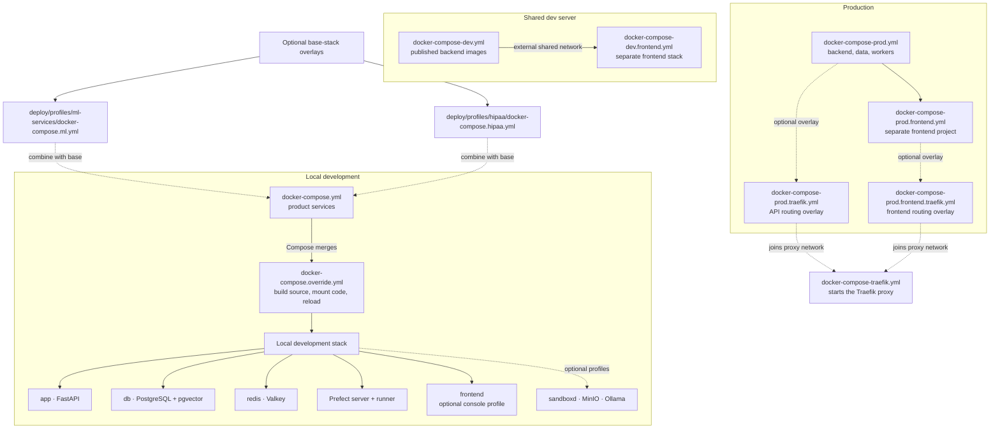
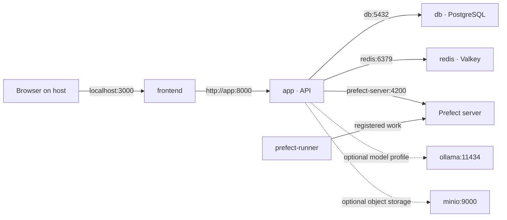
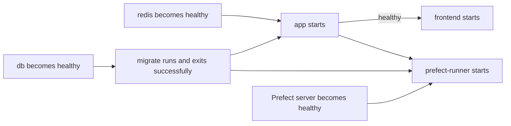

# AgenticOS Compose guide

This repository has several Compose files because it supports different ways to
run AgenticOS. They are **not all loaded together**. Each command selects a
specific stack, sometimes with a second file that adds or changes part of it.

The most useful rule is:

> A Compose file is either a complete stack, an overlay for another stack, or a
> separately started service. Check the command and the file header to see which.

## Architecture at a glance



In the diagram, dotted arrows mean "optional". `docker-compose-dev.yml` and
`docker-compose-prod.yml` are independent environment stacks; they do not
inherit the root product file. The ML-services and HIPAA files are overlays
that are explicitly combined with the root base file.

## Which file does what?

| File | Role | Intended use |
|---|---|---|
| [`docker-compose.yml`](docker-compose.yml) | Base product stack: API, frontend, database, cache, workers, networks and persistent volumes | Standalone install, or the base for local development and optional overlays |
| [`docker-compose.override.yml`](docker-compose.override.yml) | Default local-development override: builds the backend/frontend from source, mounts code, enables reload, and exposes development ports | Automatically combined with `docker-compose.yml` by a bare `docker compose` command in the repository root |
| [`docker-compose-dev.yml`](docker-compose-dev.yml) | Complete shared-dev backend stack using published images, with no source mounts; includes optional Keycloak for SSO testing | `make dev-server` |
| [`docker-compose-dev.frontend.yml`](docker-compose-dev.frontend.yml) | Frontend for the shared dev server; joins its external network | `make dev-server-frontend`, after the backend stack is up |
| [`docker-compose-prod.yml`](docker-compose-prod.yml) | Complete production backend/data/worker stack, with separate data and egress networks | `make prod` |
| [`docker-compose-prod.frontend.yml`](docker-compose-prod.frontend.yml) | Production frontend, deliberately managed as its own Compose project | `make prod-frontend`, after the backend stack is up |
| [`docker-compose-traefik.yml`](docker-compose-traefik.yml) | Runs a Traefik proxy on a pre-created external network | Start only when this deployment needs to run its own Traefik |
| [`docker-compose-prod.traefik.yml`](docker-compose-prod.traefik.yml) | Adds Traefik network membership and routing labels to the production API | Overlay selected with `make prod PROXY=traefik` |
| [`docker-compose-prod.frontend.traefik.yml`](docker-compose-prod.frontend.traefik.yml) | Adds Traefik network membership and routing labels to the production frontend | Overlay selected with `make prod-frontend PROXY=traefik` |
| [`deploy/profiles/ml-services/docker-compose.ml.yml`](deploy/profiles/ml-services/docker-compose.ml.yml) | Adds a separately resourced API replica for ML endpoints | Explicitly combined with the root base file; route `/api/v1/ml/` to `ml-services` |
| [`deploy/profiles/hipaa/docker-compose.hipaa.yml`](deploy/profiles/hipaa/docker-compose.hipaa.yml) | Tightens settings for a HIPAA-oriented deployment and requires externally configured secure services | Explicitly combined with the root base file; not a compliance guarantee by itself |

### Complete stacks versus overlays

A **complete stack** defines the services it needs to run in that environment.
For example, `docker-compose-prod.yml` defines its own API, database and
networks. It is not layered on `docker-compose.yml`.

An **overlay** only defines the changes or additions it needs. It must be
combined with its base using `-f`. The order matters: Compose reads files from
left to right, and later files modify matching services from earlier files.

The frontend files for the dev server and production are separate stacks, not
overlays on the backend files. They use an external network created by their
backend stack. Production also gives its frontend the project name
`agenticos-frontend`; keep that separate project name so its `down` command
cannot treat backend containers as orphans.

## The local development stack

### What a bare Compose command loads

From the repository root, Docker Compose automatically loads
`docker-compose.yml` and the conventionally named
`docker-compose.override.yml`. The override changes selected services while
leaving the rest of the base intact:

- The backend image is built from `backend/Dockerfile` and tagged
  `agenticos_backend:dev`.
- The app and worker mount source directories from the checkout.
- The API uses the reload supervisor.
- Database, Valkey and Prefect ports are published for local tools.
- The containerized frontend is put behind the `console` profile, so it does
  not compete with `bun dev` for port 3000.

The result is a merged configuration, not two running applications. To inspect
it without starting containers:

```powershell
docker compose config
```

When you specify `-f` yourself, list the files you want explicitly. Do not
assume another file will be added to that list automatically. The project
Makefile pins the local pair in `COMPOSE_LOCAL`.

### Recommended local commands

Use the Makefile targets where available; they include project-specific
preparation such as generating the sandbox token.

```bash
make dev
make dev-frontend
make dev-logs
make dev-down
```

`make dev` starts the local stack and enables the `sandbox` profile by default.
The host-run frontend is an alternative to `make dev-frontend`; choose one
frontend, not both, because both use port 3000.

On Windows, run Makefile commands from WSL2 with Docker Desktop's WSL
integration enabled. Docker Compose commands can also be run from PowerShell in
the repository directory.

### Profile-gated services

Profiles keep optional services from starting unless you ask for them. The
following profiles are defined across the root and shared-dev Compose files:

| Service | Profile | Start it |
|---|---|---|
| `sandboxd` | `sandbox` | `make dev` enables this profile; it requires `SANDBOXD_TOKEN` and mounts the Docker socket |
| `minio` | `objectstore` | `docker compose --profile objectstore up -d minio` |
| `ollama` | `ollama` | `docker compose --profile ollama up -d ollama` |
| containerized `frontend` | `console` in local development | `make dev-frontend` |
| `keycloak` | `sso` in the shared dev-server stack | `docker compose --env-file backend/.env -f docker-compose-dev.yml --profile sso up -d keycloak` |

The base file's default `frontend` is enabled normally for a standalone install.
The local override adds the `console` profile to it. The profile only changes
whether that service starts; it does not change how the frontend talks to the
backend.

The Ollama service persists downloaded models in the `ollama_data` volume. To
pull a model and then connect an AgenticOS model profile to it:

```powershell
docker compose --profile ollama up -d ollama
docker compose exec ollama ollama pull qwen2.5:7b
```

Use provider `Ollama`, model ID `qwen2.5:7b`, no key and endpoint
`http://ollama:11434/v1`. The container reaches Ollama by its Compose service
name. The published Ollama port binds to host loopback only.

Profiles can be combined, for example:

```powershell
docker compose --profile sandbox --profile ollama up -d
```

## How the services communicate

Compose creates a private network for a project. Containers on that network
find each other by **service name**, not by a fixed container IP:



`localhost` means the machine or container that uses it. Thus the browser opens
the host-published frontend at `localhost:3000`, while the frontend container
uses `http://app:8000` to reach the backend. A container should not use
`localhost` to reach another container; inside it, `localhost` refers to itself.

The `ports` setting publishes a container port on the host. Services that do
not need host access can remain reachable only over their Compose network.
Named volumes keep data outside the lifetime of a container: for example,
`postgres_data` stores the database and `ollama_data` stores Ollama models.
`docker compose down` removes containers and networks but keeps named volumes;
`docker compose down -v` removes those volumes too.

## Startup order and health

The base and deployment stacks use `depends_on` conditions to express startup
requirements:



The migration container is a one-shot service; it is expected to exit after it
finishes. If the API does not start, inspect the migration output:

```powershell
docker compose logs migrate
docker compose ps
docker compose logs -f app
```

`depends_on` does not mean every service waits for every other service. Follow
the specific dependency and health-check condition in the file you are running.

## Shared development server

This is a deployed test environment, not the laptop/source-mounted environment.
The backend stack uses published GHCR images, no reload mounts, and keeps the
database and Valkey ports private. The frontend is started separately because
its file joins the backend's external network.

```bash
make dev-server
make dev-server-frontend
```

The backend file creates a named network (default `agenticos_backend`). The
frontend file marks that network `external: true`, so start the backend stack
first. `backend/.env` must exist and contain the required server secrets and
public frontend URLs. `make stage` is a legacy alias for `make dev-server`.

## Production and reverse proxies

Production is also a separate stack. `docker-compose-prod.yml` divides
networking into:

- `data`, an internal network for PostgreSQL and Valkey.
- `edge`, where the API and worker reach external model providers and services.

The production frontend has its own file and Compose project. Start the
backend before the frontend:

```bash
make prod
make prod-frontend
```

Without Traefik, the production services publish loopback ports for a reverse
proxy running on the host; [`nginx/nginx.conf`](nginx/nginx.conf) is the
project's example. Use Traefik overlays only when routing through Traefik:

```bash
make prod PROXY=traefik
make prod-frontend PROXY=traefik
```

The Traefik overlays add networks and labels; they do not start a Traefik
container. If this deployment needs its own proxy, first create its external
network and start [`docker-compose-traefik.yml`](docker-compose-traefik.yml)
according to [`docs/deploy.md`](docs/deploy.md). If Traefik already runs
elsewhere, configure the overlays to join its existing network instead.

## Additional overlays

These are advanced deployment options. They are not loaded by `make dev`,
`make dev-server` or `make prod`.

### ML services replica

`deploy/profiles/ml-services/docker-compose.ml.yml` extends the base `app`
service into a separately resourced `ml-services` process. Combine it with
the base file explicitly:

```powershell
docker compose -f docker-compose.yml `
  -f deploy/profiles/ml-services/docker-compose.ml.yml up -d
```

It does not include ingress configuration. Route `/api/v1/ml/` to
`ml-services:8000` and other API paths to `app:8000`; see
[`deploy/profiles/ml-services/README.md`](deploy/profiles/ml-services/README.md)
for the routing details.

### HIPAA-oriented profile

`deploy/profiles/hipaa/docker-compose.hipaa.yml` overlays settings on the base
app and worker. It requires operator-supplied secrets and external Postgres and
Redis services with TLS. It does **not** encrypt host volumes or certify a
deployment as HIPAA compliant. Read the profile README and run the project's
deployment checks before relying on it:

```powershell
docker compose -f docker-compose.yml `
  -f deploy/profiles/hipaa/docker-compose.hipaa.yml config
```

## Handy Compose commands

Run these from the root of the repository. PowerShell users can use these
commands directly; use WSL2 for `make` if GNU Make is not installed on Windows.

```powershell
# See the effective merged local configuration without starting containers.
docker compose config

# See containers in the selected local stack.
docker compose ps

# Follow one service's logs.
docker compose logs -f app

# Start or stop the local Ollama service.
docker compose --profile ollama up -d ollama
docker compose --profile ollama stop ollama

# Stop local services across the profiles you may have started, preserving volumes.
docker compose --profile sandbox --profile console --profile objectstore --profile ollama down
```

Avoid `down -v` unless you intend to delete local database, uploaded-file,
object-store and model data.
