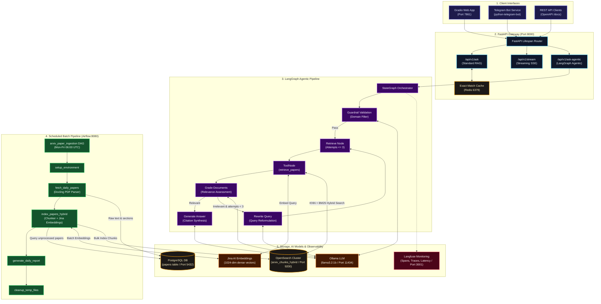
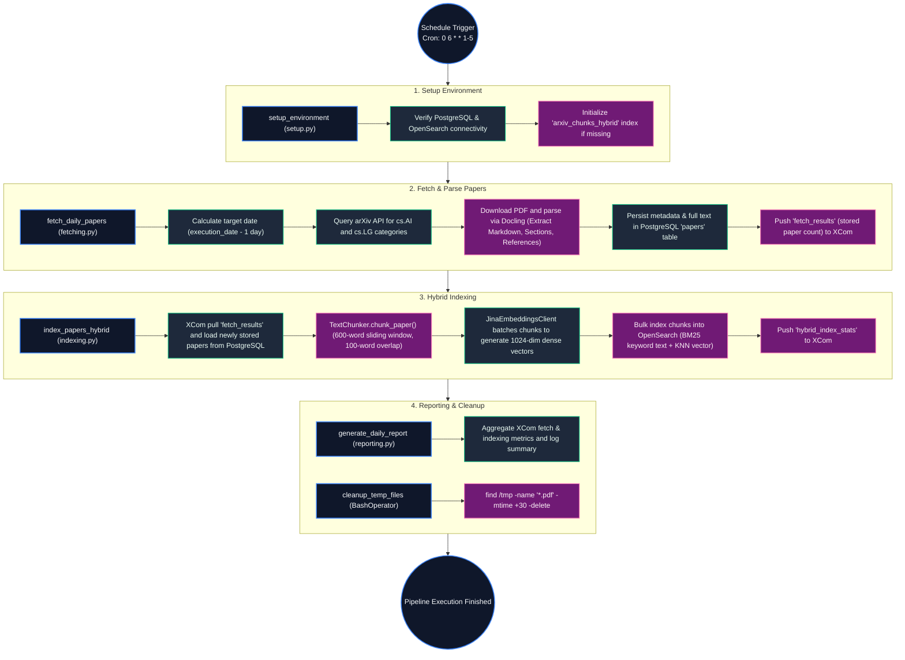
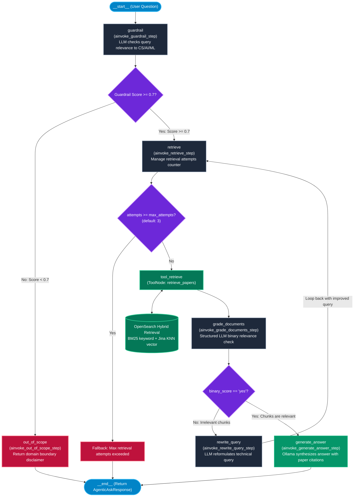
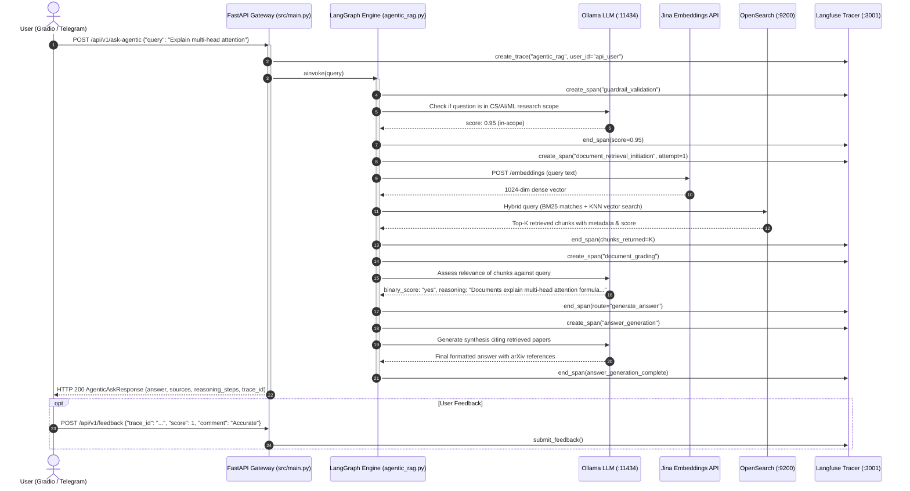
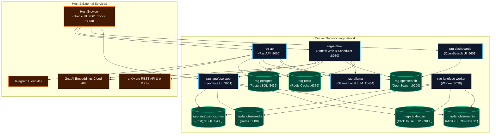

# System Execution & Architecture Guide

This document details the end-to-end execution flow of the **arXiv Paper Curator** Production Agentic RAG system. It covers both the **Batch Data Ingestion Pipeline** (orchestrated with Apache Airflow) and the **Real-Time Agentic RAG Serving Engine** (orchestrated with FastAPI, LangGraph, Ollama, and OpenSearch).

---

## 1. High-Level Macro System Architecture

The project operates across two interconnected execution tracks:
1. **Scheduled Batch Ingestion Track (Airflow)**: Automatically triggers daily, queries arXiv, parses academic research PDFs using Docling, stores metadata & full text in PostgreSQL, computes overlapping text chunks, generates dense vector representations with Jina AI, and populates the OpenSearch hybrid index.
2. **Interactive Agentic Query Track (FastAPI + LangGraph)**: Receives questions via Gradio UI, Telegram bot, or REST API, routes queries through a multi-node LangGraph StateGraph (domain guardrail validation, tool-based hybrid retrieval, LLM-based document grading, self-correcting query rewrites, and cited answer synthesis), and records full traces with Langfuse.

---

## 2. Airflow Data Ingestion Pipeline

The batch pipeline is declared in [airflow/dags/arxiv_paper_ingestion.py](file:///c:/Users/Mekin.Jemal/OneDrive%20-%20Safaricom%20Ethiopia/Desktop/Projects/LLM/production-agentic-rag-course-main/airflow/dags/arxiv_paper_ingestion.py) and executes on a defined schedule (`0 6 * * 1-5` UTC):

---

## 3. LangGraph Agentic RAG Decision Cycle

Configured in [src/services/agents/agentic_rag.py](file:///c:/Users/Mekin.Jemal/OneDrive%20-%20Safaricom%20Ethiopia/Desktop/Projects/LLM/production-agentic-rag-course-main/src/services/agents/agentic_rag.py), this cyclic graph adaptively validates, retrieves, grades, rewrites, and answers:

---

## 4. End-to-End Query-to-Answer Sequence

This sequence diagram illustrates the call path when a user submits a question to `/api/v1/ask-agentic`:

---

## 5. Docker Compose Microservices Topology

All runtime components run as services within the single `rag-network` bridge defined in [compose.yml](file:///c:/Users/Mekin.Jemal/OneDrive%20-%20Safaricom%20Ethiopia/Desktop/Projects/LLM/production-agentic-rag-course-main/compose.yml):

---

## 6. Execution Components & File Directory Mapping

| Layer / Subsystem | Primary Implementation Files | Key Responsibilities |
| :--- | :--- | :--- |
| **API Entrypoint** | [src/main.py](file:///c:/Users/Mekin.Jemal/OneDrive%20-%20Safaricom%20Ethiopia/Desktop/Projects/LLM/production-agentic-rag-course-main/src/main.py) | Application lifespan, service registry injection, router binding |
| **Agentic StateGraph** | [src/services/agents/agentic_rag.py](file:///c:/Users/Mekin.Jemal/OneDrive%20-%20Safaricom%20Ethiopia/Desktop/Projects/LLM/production-agentic-rag-course-main/src/services/agents/agentic_rag.py) | Compiles LangGraph workflow with typed `Context` and `AgentState` |
| **Agent Node Handlers** | [src/services/agents/nodes/](file:///c:/Users/Mekin.Jemal/OneDrive%20-%20Safaricom%20Ethiopia/Desktop/Projects/LLM/production-agentic-rag-course-main/src/services/agents/nodes) | Individual execution steps: Guardrail, Retrieve, Grade, Rewrite, Generate |
| **Scheduled Batch DAG** | [airflow/dags/arxiv_paper_ingestion.py](file:///c:/Users/Mekin.Jemal/OneDrive%20-%20Safaricom%20Ethiopia/Desktop/Projects/LLM/production-agentic-rag-course-main/airflow/dags/arxiv_paper_ingestion.py) | Orchestrates setup, fetching, hybrid indexing, report, and cleanup |
| **PDF Extraction** | [src/services/pdf_parser/docling.py](file:///c:/Users/Mekin.Jemal/OneDrive%20-%20Safaricom%20Ethiopia/Desktop/Projects/LLM/production-agentic-rag-course-main/src/services/pdf_parser/docling.py) | Layout-aware document parser extracting sections, references, & markdown |
| **Text Chunking** | [src/services/indexing/text_chunker.py](file:///c:/Users/Mekin.Jemal/OneDrive%20-%20Safaricom%20Ethiopia/Desktop/Projects/LLM/production-agentic-rag-course-main/src/services/indexing/text_chunker.py) | Sliding window chunking (600 words, 100 word overlap) preserving metadata |
| **Hybrid Search** | [src/services/opensearch/client.py](file:///c:/Users/Mekin.Jemal/OneDrive%20-%20Safaricom%20Ethiopia/Desktop/Projects/LLM/production-agentic-rag-course-main/src/services/opensearch/client.py) | Unifies OpenSearch BM25 keyword queries with KNN dense vector queries |
| **Dense Embeddings** | [src/services/embeddings/jina_client.py](file:///c:/Users/Mekin.Jemal/OneDrive%20-%20Safaricom%20Ethiopia/Desktop/Projects/LLM/production-agentic-rag-course-main/src/services/embeddings/jina_client.py) | Jina AI Embeddings v3 client generating 1024-dim dense vectors |
| **Local LLM Engine** | [src/services/ollama/client.py](file:///c:/Users/Mekin.Jemal/OneDrive%20-%20Safaricom%20Ethiopia/Desktop/Projects/LLM/production-agentic-rag-course-main/src/services/ollama/client.py) | Local inference for grading, rewriting, synthesis, and streaming |
| **Observability** | [src/services/langfuse/tracer.py](file:///c:/Users/Mekin.Jemal/OneDrive%20-%20Safaricom%20Ethiopia/Desktop/Projects/LLM/production-agentic-rag-course-main/src/services/langfuse/tracer.py) | Wraps requests with Langfuse traces, node spans, token counts, and feedback |
